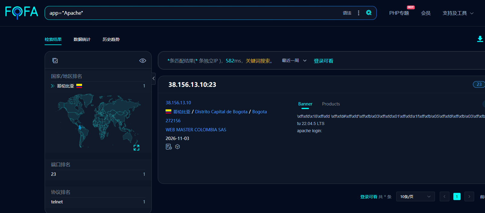
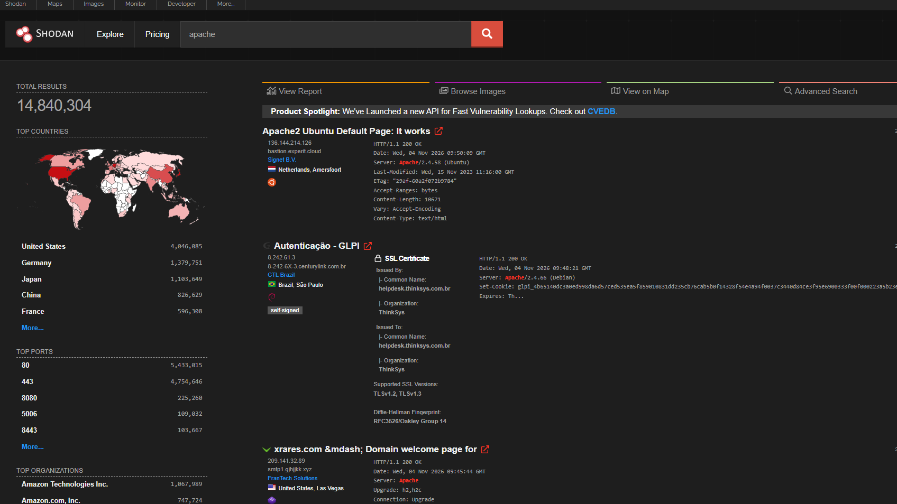
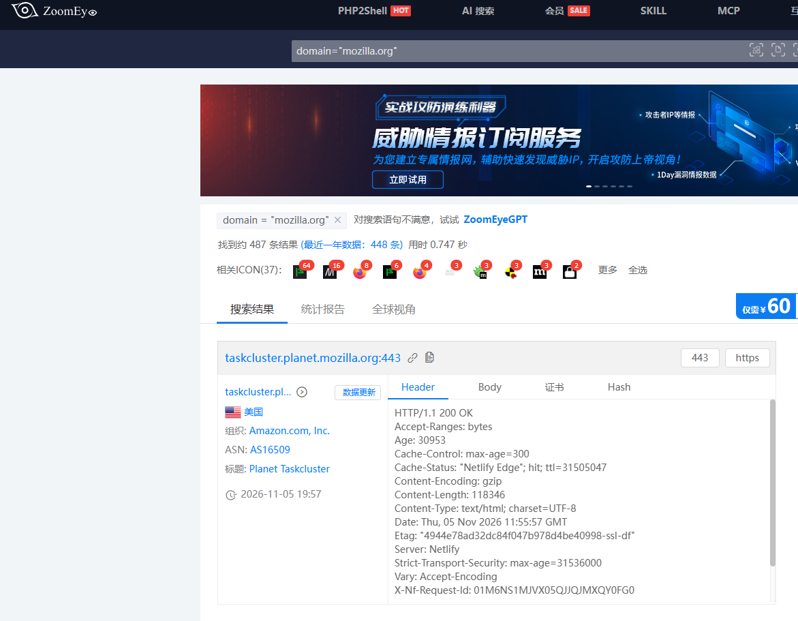

> 本实验熟悉网络空间测绘引擎，利用测绘平台收集目标资产，学习检索语法，完成资产测绘与子域名收集。

国内知名测绘平台之一，语法丰富，支持检索 `title`、`body`、`iconhash`、`cert`、`domain` 检索资产，国内资产覆盖度高。

## 2. Shodan
全球知名联网设备搜索引擎，重点偏向端口与服务测绘，国外资产丰富，也可以结合证书字段辅助挖掘子域名。

## 3. 其他补充
- **crt.sh**：证书透明度查询站，依靠 SSL 证书提取子域名；

ZoomEye 的 `domain:"mozilla.org"` 语法是收集子域名最常用手段。

常用检索语句：

## 实验小结
测绘引擎可以快速批量拿到公网暴露资产，配合子域名工具能够快速扩大目标攻击面；测绘属于信息收集环节，必须遵守法律法规，仅用于授权范围内的安全测试。
