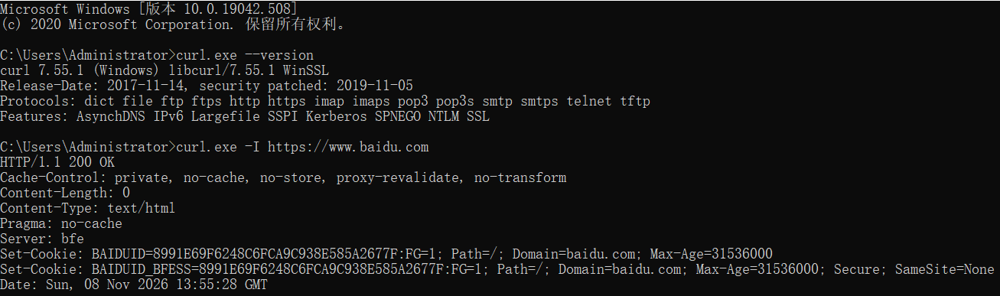
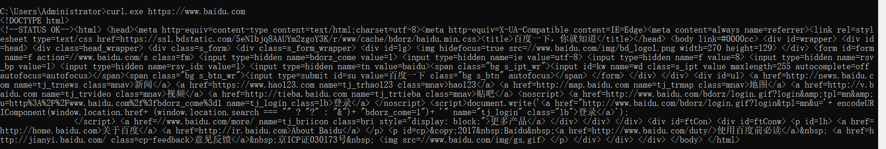
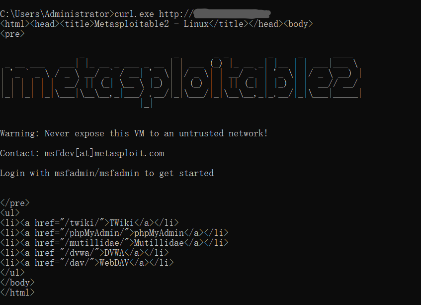

## 实验简介
curl（Client URL）是命令行网络工具，支持HTTP、HTTPS等协议，常用于服务探测、API调试。本次在Windows 10上完成基础测试。

## 环境
- Windows10，curl 7.55.1
- 公网：百度 https://www.baidu.com
- 内网靶机：Metasploitable2 

## 操作

1. 查看版本
curl.exe --version
2. 获取 HTTP 响应头
curl.exe -I https://www.baidu.com

3. 获取网页完整源码
curl.exe https://www.baidu.com

4. 访问内网漏洞靶机
curl.exe http://192.168.xxx.xxx

