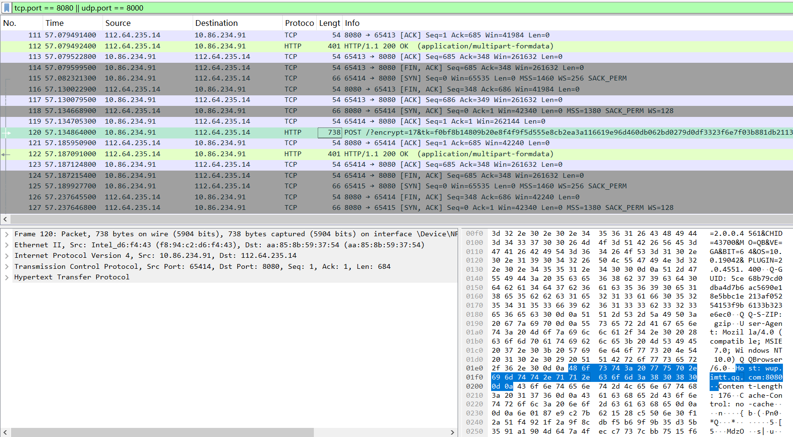
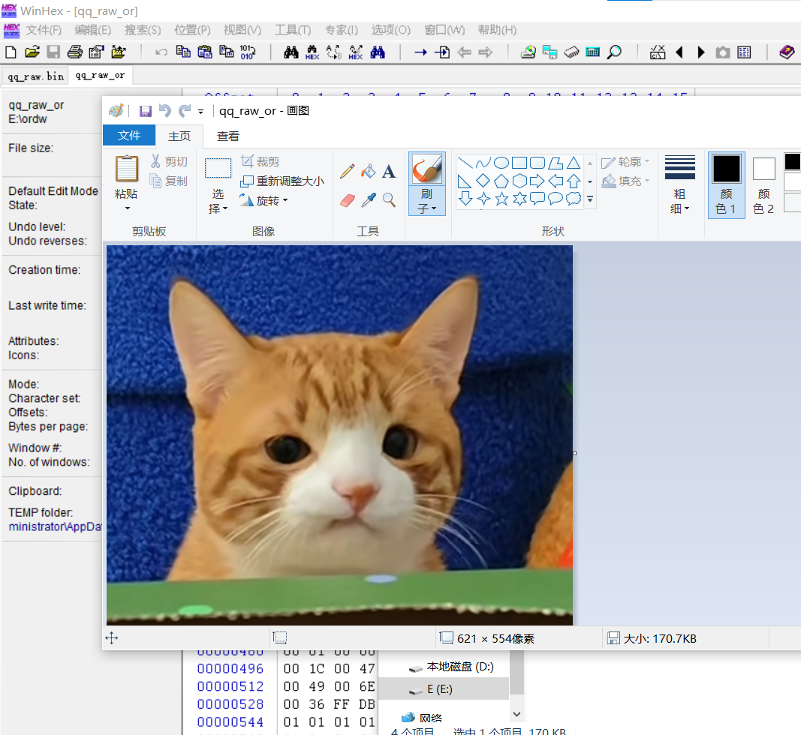

---
layout:port
title:QQ流量分析实验（PC-手机端）
tage:wireshark 网络协议 流量分析
---

## 实验目的
捕获QQ图片传输流量，分析：
1. QQ传输使用 UDP 还是 TCP
2. 传输载荷是加密还是明文
3. 根据文件特征码尝试恢复传输的图片文件
对比 PC发给PC、PC发给手机两种场景；捕获流量后使用Wireshark抓包、WinHex二进制分析，发布博客，全程脱敏保护个人隐私。

## 实验环境
- 抓包主机：Windows 10
- 抓包工具：Wireshark
- 二进制分析工具：WinHex
- 客户端：PC版QQ、手机QQ
- 传输内容：JPG图片（小猫图）
- 过滤规则：`tcp.port == 8080 || udp.port == 8000` / `ip.addr == 目标IP`

## 一、协议：UDP or TCP？
QQ是**TCP+UDP混合使用**：
1. 心跳、简单即时消息、OICQ原生协议：优先 **UDP**（8000端口为主），无连接，NAT穿透好、延迟低；
2. **图片、文件这类大数据传输（本次实验）：使用TCP**（HTTP POST上传到腾讯服务器，8080端口），面向连接、可靠传输、分片重组，保证图片完整送达。
> 本次抓包看到大量TCP三次握手、PSH/ACK分片包、HTTP POST请求，图片走TCP上传腾讯服务器中转（PC→腾讯服务器→手机/另一台PC，不是直连）。

## 二、加密 or 明文？
**主体载荷是加密传输**。
- HTTP头部（Host、Content-Type等）是明文；
- 图片的二进制主体数据在HTTP body内做了QQ业务加密，不是裸JPG明文；
- 特殊点：在导出的完整流量二进制bin文件中，**可以检索到JPG特征头 `FF D8 FF`（JPG起始标记）和 `FF D9`（JPG结束标记）**，这是本实验可以恢复图片的关键。
> 不是整段裸明文传输图片，但在流量二进制流里残留了JPG文件特征片段，可以靠特征码切割提取。

## 三、文件恢复过程（JPG特征码恢复）
JPG固定特征：
- 文件起始：`FF D8 FF`（SOI，图像开始）
- 文件结束：`FF D9`（EOI，图像结束）

操作步骤：
1. Wireshark导出全部流量原始数据为 `qq_raw.bin`；
2. WinHex打开bin文件，搜索十六进制 `FF D8 FF`，定位图片起始位置；
3. 从`FF D8 FF`开始，一直截取到 `FF D9`；
4. 选中区块 → 编辑 → 置入新文件，保存为 `.jpg`；
5. 打开图片，成功还原出传输的小猫图片，大小170KB左右。

> 原理：在线传输时，图片原始文件流被封装在加密/HTTP封装包内，但是图片本身的二进制文件结构没有被破坏，依靠文件头特征码切割提取。

## 四、PC-PC、PC-手机端对比小结
1. PC发给PC：同样走TCP上传腾讯服务器中转，协议流程一致；
2. PC发给手机：同样是TCP+HTTP POST上传，服务器转发给手机QQ；
> 现代QQ图片**不支持客户端P2P直传**，统一走腾讯服务端转发，两种场景协议模型一致；区别只是接收端设备不同。

## 实验总结
1. QQ通信：**UDP用于心跳/轻消息，TCP用于图片、文件等大数据传输**；
2. 传输：HTTP头明文，图片主体业务加密；但图片本身二进制结构保留，可以依靠文件特征头`FF D8 FF`从流量dump中恢复图片；
3. 恢复思路：不同文件拥有独有的头部特征码，抓包导出原始二进制流，检索特征标记，截取片段，重建文件；
4. 安全提示：本实验仅学习流量分析原理；私自抓包他人通信流量属于违规行为。

---
### 截图（对应你assets/img，按需放）

